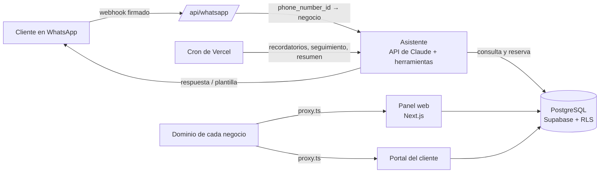

# Wapoo

**Plataforma SaaS de atención, turnos y cobros por WhatsApp, con un asistente de IA.**
Le contesta a los clientes de un negocio a cualquier hora, les da turno en los horarios libres, cobra la seña leyendo el comprobante de transferencia y manda los recordatorios. El negocio lo gestiona todo desde un panel web.

> *English summary:* multi-tenant SaaS (Next.js 16, PostgreSQL/Supabase with Row Level Security, Claude API, WhatsApp Cloud API) where an AI assistant answers a business's WhatsApp 24/7, books appointments, verifies payment receipts and sends reminders. In production since September 2026.

Este repositorio es una **copia pública** del código que está en producción. Los datos del cliente real (nombres, teléfonos, cuentas de pago, logos y material de estudio) se reemplazaron por datos de ejemplo ("Academia Demo").

---

## En producción

Atiende desde septiembre de 2026 el WhatsApp de una academia en Argentina.

| | |
|---|---|
| **16 s** | mediana de respuesta del asistente (incluye una pausa a propósito por si el cliente manda otro mensaje) |
| **1 de cada 5** | respuestas salen entre las 22 y las 9, fuera del horario de atención |
| **~USD 6 / mes** | costo de IA por cliente, con caché de prompts |
| **39 / 39** | controles de la prueba automática de aislamiento entre clientes |

## Qué hace

**Asistente de WhatsApp (API de Claude con herramientas)**
- Responde precios, horarios y modalidades con los datos de cada negocio.
- Registra clientes nuevos, da turnos en horarios libres y los reprograma según las reglas de anticipación y de seña.
- Coordina clases grupales: antes de mover una clase consulta a cada integrante, aplica el cambio y recalcula los precios.
- Lee comprobantes de pago (imagen o PDF), verifica el monto y la cuenta de destino, y confirma la seña.
- Manda recordatorios (la noche anterior y la misma mañana) y pregunta cómo le fue al cliente después de la clase.
- Deriva a una persona ante un reclamo o un pago que no cierra. El negocio puede tomar cualquier conversación desde el panel.

**Panel de gestión**: agenda (día, semana y mes), fichas de clientes, finanzas y deudas, liquidación por profesional, equipo con roles, días sin atención, notificaciones *push* y un resumen cada mañana.

**Portal del cliente final**: entra con un código, sin contraseña. Ve sus turnos y el estado de cada pago, y reserva en los horarios libres. Las horas se muestran en su zona horaria.

**Plataforma multi-cliente**: alta de negocios, dominio propio, marca (logo y colores), moneda, zona horaria, duraciones de turno, un número de WhatsApp por cliente y control del abono mensual y del consumo de IA.

## Arquitectura



## Decisiones técnicas

- **Aislamiento de datos en la base, no solo en el código.** Las 25 tablas de negocio tienen `organizacion_id` y políticas de *Row Level Security* atadas a la organización del usuario (`org_actual()`). Del lado del servidor, un *wrapper* (`lib/supabase/org.ts`) filtra y completa la organización en cada consulta, y una regla de ESLint impide usar el cliente con privilegios fuera de los archivos autorizados. `scripts/prueba-aislamiento.ts` arma dos negocios y verifica que ninguno vea datos del otro, incluidas las respuestas del asistente.
- **Pasar de un cliente a varios sin cortar el servicio.** El sistema se hizo primero para una sola academia y se volvió multi-cliente en pasos chicos. Cada paso se comparó contra el comportamiento anterior (más de 10.000 conversiones horarias, 5.000 montos, los textos del asistente) mientras el bot seguía atendiendo a usuarios reales.
- **Un número de WhatsApp por cliente.** El webhook enruta cada mensaje por `phone_number_id` y verifica la firma HMAC con el secreto de la app de Meta que corresponde. Los tokens de cada cliente se guardan cifrados en Supabase Vault.
- **Costo de IA controlado.** Caché de prompts, registro de tokens y costo por llamada y por cliente, y un tope incluido en el abono con el excedente medido.
- **Fechas y zonas horarias.** Cada negocio tiene su zona horaria y cada cliente final ve las horas en la suya, con el cambio de horario de verano resuelto.

## Stack

- **Frontend:** Next.js 16 (App Router, Server Actions), React 19, TypeScript, Tailwind CSS 4, PWA.
- **Datos:** PostgreSQL en Supabase (RLS, funciones SQL, Vault, Storage).
- **IA:** API de Claude (Anthropic) con *tool use*, caché de prompts y búsqueda web.
- **Integraciones:** WhatsApp Cloud API (Meta), Web Push (VAPID).
- **Infraestructura:** Vercel, con cron jobs.

## Estructura

```
app/                rutas: panel, portal del alumno, páginas públicas, API (whatsapp, cron, bot)
app/actions/        server actions del panel y de la plataforma
components/         UI por módulo (agenda, alumnos, bot, plataforma…)
lib/bot/            asistente: prompt, herramientas, comprobantes, recordatorios, coordinación de grupales
lib/                datos, reglas de agenda, fechas y zonas, cobros, organización (multi-cliente)
supabase/schema.sql esquema completo, con cada cambio en orden
scripts/            pruebas de aislamiento, de flujos del bot y una batería de conversaciones
```

## Cómo correrlo

1. Crear un proyecto en Supabase y correr `supabase/schema.sql` en el SQL Editor.
2. Copiar `.env.example` a `.env.local` y completar las claves de Supabase, Anthropic, WhatsApp y VAPID.
3. Instalar y levantar:

```bash
npm install
npm run dev
```

## Autor

**Javier Balastegui**: diseño, desarrollo, despliegue y operación.
javier123balastegui@gmail.com
